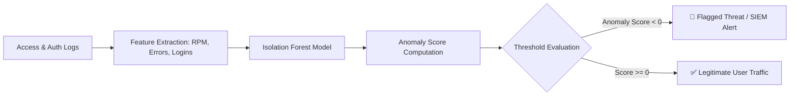

# 🔍 Log Anomaly Detector ML (Unsupervised SIEM Tool)

[](https://www.python.org/)
[](https://scikit-learn.org/)
[](#)
[](https://opensource.org/licenses/MIT)

An unsupervised Machine Learning framework that automatically detects **cyberattacks, brute-force login attempts, and DDoS anomalies** from server and network access logs using **Isolation Forest**.

---

## 💡 Why Unsupervised Learning for Cyber Security?
Traditional signature-based intrusion detection systems (IDS) fail against zero-day threats or evolving attack behaviors.  
This tool utilizes **Isolation Forest**, an unsupervised anomaly detection algorithm that separates anomalies instead of profiling normal points, making it exceptionally fast and effective for high-volume server log streams.

---

## ⚙️ Analyzed Behavioral Features
- **Requests per Minute (`req_per_min`):** Sudden high traffic spikes (DDoS or directory scraping).
- **Failed Login Attempts (`failed_logins`):** Repetitive authentication failures (Credential stuffing & Brute-force).
- **Unique Endpoints Visited (`unique_endpoints`):** Broad endpoint querying (Web vulnerability crawling).
- **Client Error Responses (`error_4xx_count`):** Probing non-existent paths (404/403 fuzzing).

---

## 🧠 Workflow Diagram



---

## 🚀 How to Run

1. **Clone the repo:**
   ```bash
   git clone https://github.com/your-username/Log-Anomaly-Detector-ML.git
   cd Log-Anomaly-Detector-ML
   ```

2. **Setup virtual environment:**
   ```bash
   python -m venv venv
   # Windows:
   venv\Scripts\activate
   # Linux / macOS:
   source venv/bin/activate
   ```

3. **Install dependencies:**
   ```bash
   pip install -r requirements.txt
   ```

4. **Run the script:**
   ```bash
   python anomaly_detector.py
   ```

---

## 📈 Sample Detection Output
```text
🔍 SIEM / Ağ Trafiği İçin Makine Öğrenmesi ile Anomali Tespiti
[*] Toplam incelenen IP oturumu: 620
[!] Tespit Edilen Şüpheli IP Sayısı: 22

=== İlk 5 Tespit Edilen Şüpheli Aktivite ===
    ip_address  req_per_min  failed_logins  error_4xx_count       true_label
4     10.0.0.8   204.384729             38               62  Attack / Anomaly
19    10.0.0.2   174.192831             29               48  Attack / Anomaly
41   10.0.0.14   189.541290             41               55  Attack / Anomaly
```
